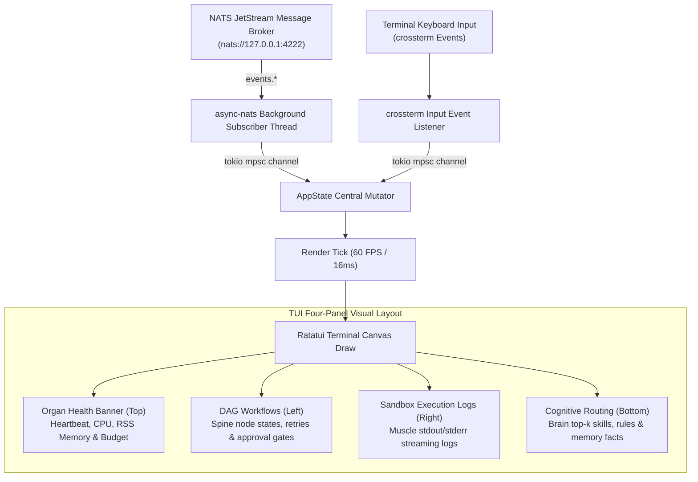

# agent-tui — Deep Operational & Architectural Context for Agents

> **Terminal Observability HUD & Real-Time Mesh Telemetry Console** — In-depth architectural guide, multi-threaded ratatui event loop, NATS subscriber mechanics, keyboard controls, and failure recovery runbooks for `agent-tui`.  
> **Ecosystem Version Baseline:** `v1.0.0-beta.3`  
> **Documentation Hub:** [https://autonomic-ai.dev/docs/telemetry](https://autonomic-ai.dev/docs/telemetry) · [Architecture Hub](https://autonomic-ai.dev/docs/architecture)  
> **Transport:** Direct NATS JetStream subscriber (`nats://127.0.0.1:4222`) · No dedicated HTTP server port

---

## 1. Executive Summary & Biological Role

In the Autonomic 11-organ architecture, **`agent-tui`** serves as the **Terminal Observability HUD and Mission Control Monitor** (analogous to `k9s`, `htop`, or `datadog-agent` for the local multi-agent cluster).

When multiple autonomous daemons run concurrently across separate processes, engineers and agents need immediate visibility into:
1. **Daemon Health & Liveness:** Are all 8 background daemons running, or did an organ crash?
2. **DAG Execution Progress:** What workflow step is `agent-spine` actively executing, and which nodes are pending human approval?
3. **Sandbox Command Logs:** What compiler or test command is currently executing in `agent-muscle`?
4. **Cognitive Routing & Token Budget:** What skills and facts were injected by `agent-brain`, and what is the active token burn rate tracked by `agent-heart`?

`agent-tui` provides a blazingly fast, native Rust terminal user interface built with `ratatui 0.30` and `crossterm`. It connects directly to the local **NATS JetStream** message mesh to display live system state without requiring a browser or web server.

---

## 2. Core Architecture & Render Pipeline



### 2.1 Multi-Threaded Decoupled Event Architecture
- **Non-blocking IO:** The NATS consumer loop runs on a dedicated background `tokio` task. Even if thousands of log lines arrive per second from an active compilation job, the UI render thread never freezes or drops frames.
- **Atomic State Mutations:** State events are serialized through a bounded `mpsc` channel into `AppState`, preventing race conditions.
- **Adaptive Terminal Resizing:** Automatically recalculates layout constraints upon terminal window resize events (`crossterm::event::Event::Resize`).

---

## 3. Four-Panel Live Display Matrix

1. **Organ Health Banner (Top Panel):**
   - Displays real-time heartbeats, CPU utilization percentages, and RSS memory consumption across all 8 daemons (`brain`, `spine`, `heart`, `nerves`, `muscle`, `immune`, `eyes`, `mouth`).
   - Highlights degraded daemons in yellow and crashed/unreachable daemons in red.
2. **DAG Workflows (Left Panel):**
   - Visualizes active, completed, and pending nodes in the active `agent-spine` DAG workflow.
   - Highlights nodes paused at `ApprovalGate` with flashing alert indicators.
3. **Sandbox Execution Logs (Right Panel):**
   - Streams live `stdout` and `stderr` output from commands executing inside `agent-muscle`.
   - Supports auto-scroll and manual review modes.
4. **Cognitive Routing & Context (Bottom Panel):**
   - Displays the last active `route_task` retrieval from `agent-brain`: injected skills, active `must_apply` rules, and memory facts.

---

## 4. Complete CLI Command Reference & Controls

### 4.1 Invocation Commands
- `agent-tui`: Launch the terminal dashboard.
  - `--nats-url <URL>`: Custom NATS broker address (default: `nats://127.0.0.1:4222`).
  - `--tick-rate <MS>`: UI refresh tick rate in milliseconds (default: `250`).
- Via the meta-CLI:
  ```bash
  autonomic tui
  ```

### 4.2 Keyboard Controls & Navigation
- `q` or `Esc`: Gracefully exit the TUI and restore terminal state.
- `Tab`: Cycle focus between the four panels.
- `Up` / `Down` or `k` / `j`: Scroll through the focused panel (logs, workflow nodes, or memory facts).
- `Space`: Pause / resume live log streaming.
- `c`: Clear focused log window buffer.

---

## 5. Troubleshooting & Recovery Runbook

### 5.1 Problem: "Connecting to NATS..." Hangs on Startup
- **Cause:** Local NATS message broker (`nats-server`) is not running.
- **Resolution:**
  - Start cluster supervision:
    ```bash
    autonomic start
    ```
  - Verify NATS port is open: `lsof -i :4222`.

### 5.2 Problem: Terminal Garbled After Forceful Kill (`SIGKILL`)
- **Cause:** Terminal raw mode was not restored because the process was killed with `kill -9`.
- **Resolution:**
  - Reset terminal state:
    ```bash
    reset
    ```
