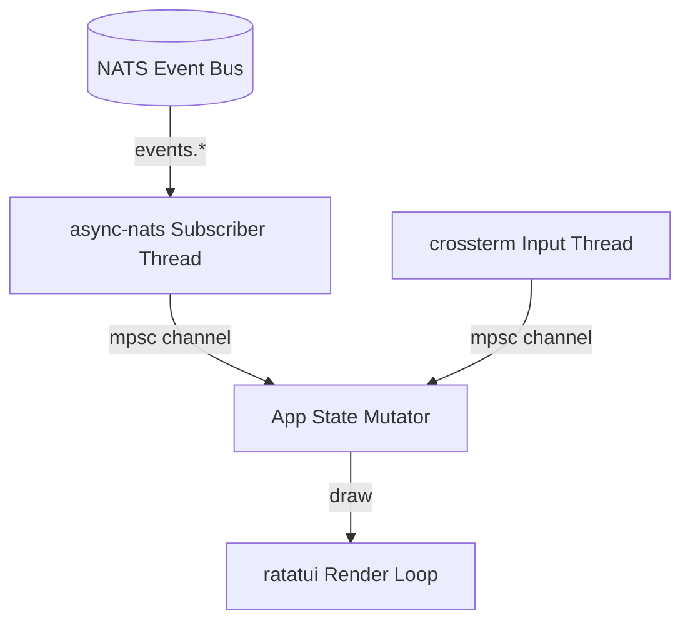

# Autonomic AI Terminal Dashboard (`agent-tui`)

Agent context: [CONTEXT.md](CONTEXT.md) · Telemetry Guide: [https://autonomic-ai.dev/docs/telemetry](https://autonomic-ai.dev/docs/telemetry) · Architecture: [https://autonomic-ai.dev/docs/architecture](https://autonomic-ai.dev/docs/architecture).

**Cloud-Native role: Terminal UI** (`k9s` / `htop` analog) — real-time organ health, DAG workflows, and sandbox logs.

## Features

- **Organ Health (Top)**: Real-time heartbeat tracking of CPU/Memory from `agent-heart`.
- **DAG Workflows (Left)**: Visualization of the deterministic DAG nodes actively executing in `agent-spine`.
- **Sandbox Logs (Right)**: Streaming standard output/error from `agent-muscle` code execution.
- **Context Routing (Bottom)**: Insights into memory chunks and rules retrieved by `agent-brain`.

## Installation

### Homebrew (macOS — Recommended)

```bash
brew tap autonomic-ai-dev/tap
brew install agent-tui
```

### Via Autonomic CLI
You do not need to clone this repository to use the TUI. The Autonomic CLI handles downloading the latest release for your architecture automatically:
```bash
autonomic tui
```

### Manual Build
Ensure you have Rust installed.
```bash
git clone https://github.com/autonomic-ai-dev/agent-tui.git
cd agent-tui
cargo build --release
./target/release/agent-tui
```

## Architecture



## Shortcuts
- `q` or `Esc`: Quit the TUI.
