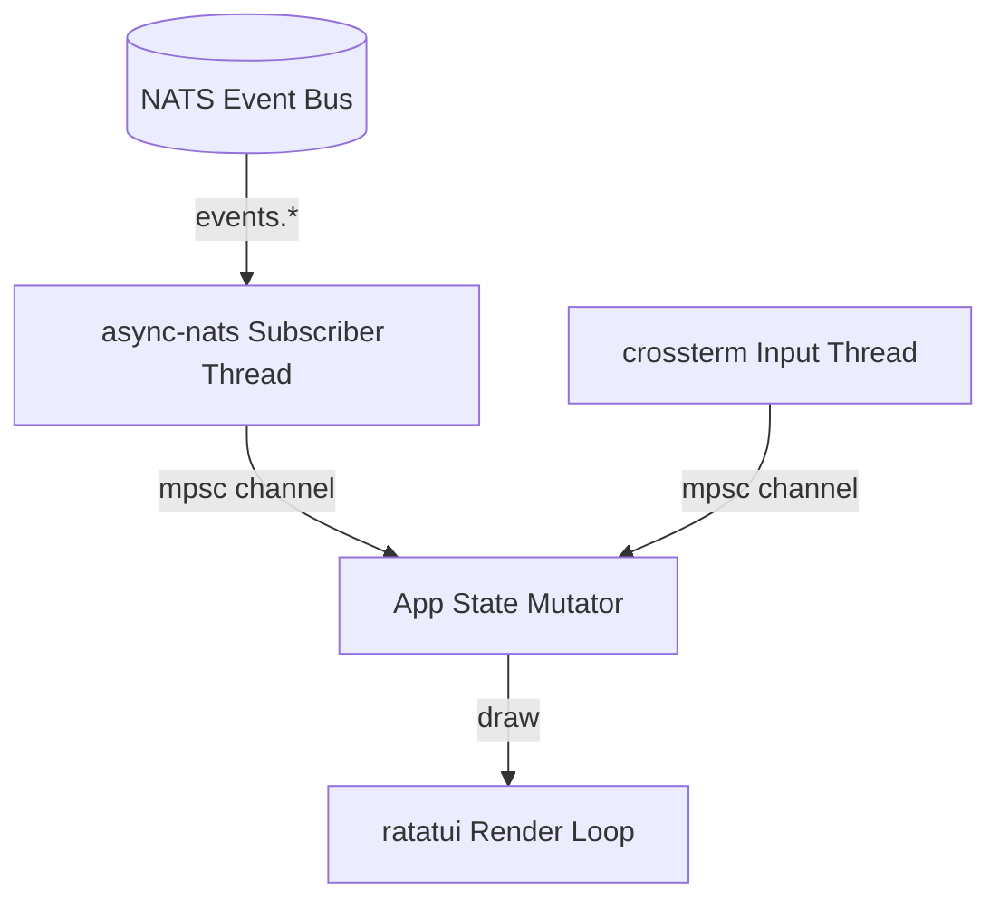

# Autonomic AI Terminal Dashboard (`agent-tui`)

Agent context: [CONTEXT.md](CONTEXT.md) · Telemetry Guide: [https://autonomic-ai.dev/docs/telemetry](https://autonomic-ai.dev/docs/telemetry) · Architecture: [https://autonomic-ai.dev/docs/architecture](https://autonomic-ai.dev/docs/architecture).

**Cloud-Native role: Terminal UI** (`k9s` / `htop` analog) — real-time organ health, DAG workflows, and sandbox logs.

## Features

The dashboard has six tabs, selected with keys `1` to `6`:

- **1 Overview**: Top-level status across the organs.
- **2 Workflows**: Workflow activity from `agent-spine` (`events.spine*`).
- **3 Mesh**: Organ health and resource use.
- **4 Brain**: Context and rules retrieved by `agent-brain` (`events.brain*`).
- **5 Logs**: Log lines from the organs.
- **6 Usage**: Token usage, quota, and budget alerts from `agent-heart` (`events.heart.*`).

The dashboard subscribes to `events.>`, `autonomic.>`, and `events.heart.>` on the NATS bus.

## Installation

### Homebrew (macOS — Recommended)

```bash
brew tap autonomic-ai-dev/tap
brew install agent-tui
```

### Via Autonomic CLI
You do not need to clone this repository to use the TUI. The Autonomic CLI handles downloading the latest release for your architecture automatically:
```bash
autonomic tui
```

### Manual Build
Ensure you have Rust installed.
```bash
git clone https://github.com/autonomic-ai-dev/agent-tui.git
cd agent-tui
cargo build --release
./target/release/agent-tui
```

## Architecture



## Shortcuts
- `1`-`6`: Switch tabs.
- `r`: Refresh.
- `q` or `Esc`: Quit the TUI.
